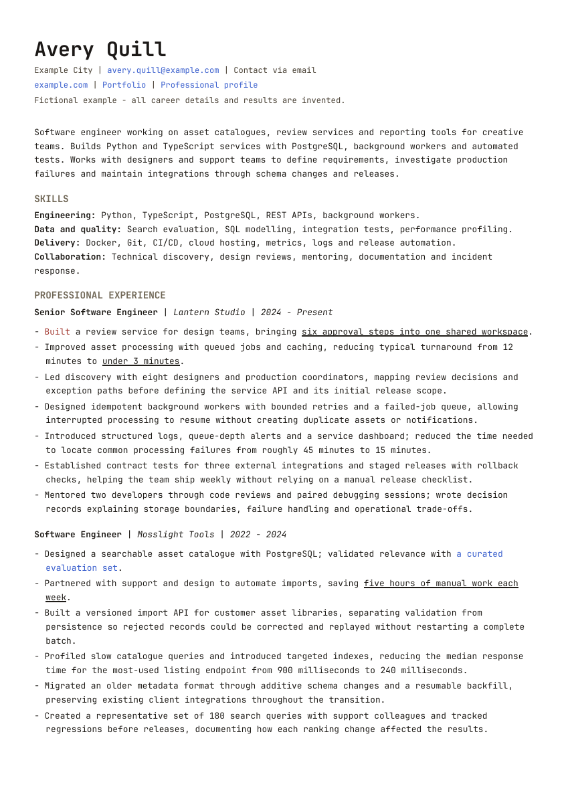

# Python CV and cover-letter starter

The Python rendering toolkit used in an existing job-hunt workflow, packaged
with fictional inputs and portable paths. It uses ReportLab and
python-docx for the standard, quantitative and
right-aligned strategy CV layouts, plus the shared cover-letter renderer.
Documents are generated locally with Python.

**Avery Quill is fictional.** All sample employers, education, credentials,
projects and results are invented. The same sample facts illustrate the layout
options across all three CVs.



[Standard PDF](output/avery-quill-swe.pdf) · [Editable Word version](output/avery-quill-swe.docx) ·
[Strategy PDF](output/avery-quill-strategy.pdf) · [Quantitative layout PDF](output/avery-quill-quant.pdf) ·
[Cover letter](output/avery-quill-cover-letter.pdf)

## Setup

Use a private copy for personal work. Install Python 3.10 or newer, then:

```sh
python3 -m venv .venv
source .venv/bin/activate
python -m pip install -r requirements.txt
python build.py --all
python build_cover_letter.py
python qa.py
```

On Windows, activate with `.venv\Scripts\activate` instead.
The default build (`python build.py`) generates the standard CV as PDF and DOCX.
The CV examples span two A4 pages; the cover letter remains one page.
The preview above shows page one. Keep the shared type sizes and check the
intended page count.

**You can let your agent do the setup and ask you for the facts.** Paste:

> Set up my CV workspace using AGENTS.md and docs/onboarding.md. Initialize the
> private files and interview me in small batches. Use my existing CV or notes
> if available, resolve uncertainties, and draft my CV and cover letter from
> confirmed facts. Build and review them with the existing Python tooling.
> Preserve the styling unless I ask for changes. Do not publish or submit.

The agent runs `python init_workspace.py`, which creates private profile,
preferences, master sources, a review log and status file without overwriting
anything. You supply your information conversationally; the agent maintains
the files. The fictional examples remain reusable references.

See [agent onboarding](docs/onboarding.md) for the interview sequence and exact
personal-document commands, and [housekeeping](docs/housekeeping.md) for source
ownership, approvals, versions, privacy and session handoff.

## Files and responsibilities

| File | Purpose |
| --- | --- |
| `build.py`, `build_cover_letter.py` | Root entry points for the design packages |
| `design/cv/` | CV rendering code, stylesheets, fonts and design guide |
| `design/cover_letter/` | Letter renderer, typography and design guide |
| `examples/*.html` | Fictional CV source documents |
| `examples/cover-letter.md` | Fictional plain-text letter source |
| `design/cv/fonts/` | Shared JetBrains Mono fonts and licence |
| `qa.py` | Portable source-content, links, geometry, font and page-count checks |
| `profile/ground-truth.example.md` | Fact collection and claim ledger worksheet |
| `AGENTS.md`, nested instructions, `CLAUDE.md` | Shared agent rules and folder ownership |
| `init_workspace.py`, `templates/` | Non-overwriting private workspace initialization |
| `personal/` | Private master sources, review log and status |
| `applications/` | Private role briefs, tailored sources and exports |
| `STATUS.md` | Distributed starter status; personal progress lives in `personal/status.md` |
| `output/` | Generated PDFs, editable DOCX files, previews and QA report |

See [code provenance](docs/provenance.md) for what was reused and what changed.

## Generate different CVs

```sh
python build.py --variant swe
python build.py --variant strategy
python build.py --variant quant
python build.py --all --format pdf
python build.py --variant swe --source examples/software-engineering.html --stem my-cv --output-dir output/custom
```

To tailor an application, copy an example into a local `applications/` folder,
edit content from ground truth and pass its path with `--source`. Keep separate
sources and output names for each role. Do not overwrite an approved master
while trying a new draft. Custom HTML must retain `article.resume`, the
`data-variant`, metadata, contact, summary, sections and paragraph classes.
For the strategy layout, keep `.dated-heading`, `.heading-details` and `time`.
The quantitative renderer expects one contact paragraph.

Without arguments, QA checks the three fictional examples and letter. For your
own documents, pass explicit source and output paths:

```sh
python qa.py --source personal/master/resume.html --pdf personal/master/outputs/resume.pdf --docx personal/master/outputs/resume.docx --personal
python qa.py --kind letter --source personal/master/cover-letter.md --pdf personal/master/outputs/cover-letter.pdf --personal
```

The examples declare `data-expected-pages="2"` in their HTML. QA reads that
value; use `--pages` to override it for another intended length. Personal checks require a
ground-truth file and reject recognizable fictional details and metadata.
Review professional claims against their sources and record the result.

## Generate cover letters

```sh
python build_cover_letter.py --source examples/cover-letter.md --output output/my-cover-letter.pdf --author "Your Name" --title "Your Name - Cover Letter" --subject "Role title"
```

The source uses blank lines between paragraphs and two spaces before a newline
for an explicit line break. Headings, lists and emphasis syntax are printed literally.
Letter typography and page settings are documented in
[the cover-letter design guide](design/cover_letter/README.md).
The cover-letter builder produces PDF; CV builders also produce editable DOCX.

## Design

CV styling and the Paper/Figma workflow live in [design/cv](design/cv/README.md).
Cover-letter typography and page layout live in
[design/cover_letter](design/cover_letter/README.md).

## Validation and previews

```sh
python build.py --all
python build_cover_letter.py
python qa.py
```

The checks cover complete source paragraphs in PDFs and DOCX, expected PDF
pages, A4 size, link destinations, embedded descriptor fonts and text bounds.
Always inspect the rendered pages for collisions and readability. Word is an
editable fallback; install the bundled fonts before viewing it. Word and
LibreOffice can paginate differently from the authoritative ReportLab PDF.

For PNG previews, install Poppler (`pdftoppm`) and run:

```sh
pdftoppm -singlefile -scale-to 1200 -png output/avery-quill-swe.pdf output/avery-quill-swe
```

Refresh previews after changing the source. See [the review workflow](docs/workflow.md).

## Privacy

Personal profile files, evidence, `personal/` and application content are ignored by
Git. Example sources and `output/` are tracked: after personalization they can
contain your career details. Review source, exports, metadata and staged files
before any push. Share the fictional starter separately from personal work.
The supplied examples are fictional. People with repository access can see
the owner and collaborators.
