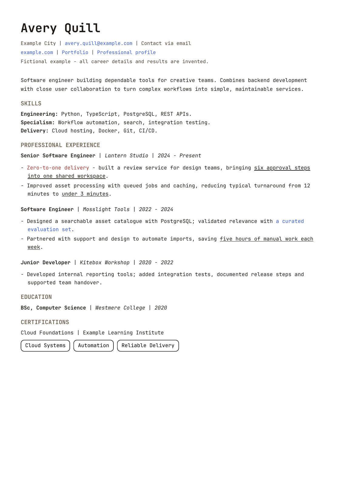

# Your CV, from facts to finished PDF

A ready-to-edit, one-page CV and a small agent-friendly authoring workflow.
Start with **Avery Quill**, a wholly fictional software engineer, then replace
that story with your own confirmed experience. All sample organisations,
credentials and results are invented. Links use example.com.



[View the sample PDF](output/cv-scaffold.pdf)

## Get started

Use a private copy of this repository for personal work. You need Node.js 20+
and npm. From the repository folder:

```sh
npm ci
npx playwright install chromium
cp profile/ground-truth.example.md profile/ground-truth.md
```

1. Fill in `profile/ground-truth.md` with confirmed facts and evidence.
2. Open `index.html` in a browser to see the sample. Edit the HTML directly,
   or ask your coding agent to draft it from your ground truth.
3. Replace the fictional name, contacts, links, employers, dates, bullets,
   education and credential. Update the HTML title and description; remove
   the fictional-example notice and comment only after replacing the story.
4. Build and check:

```sh
npm run build
npm run check
npm run check:personal
```

The PDF is at `output/cv-scaffold.pdf`. Open it and inspect every line before
sharing. `check:personal` deliberately fails on the shipped fictional sample.
It catches leftover example details; it cannot verify your career claims.

An agent prompt to get started:

> Read AGENTS.md and my profile/ground-truth.md. Ask about gaps or conflicting
> facts, then replace the fictional CV in index.html with a concise draft for
> my target role. Preserve the established style and one-page layout. Never
> invent claims or copy example metrics. Build, check and visually inspect the
> PDF. Record unresolved questions in STATUS.md. Do not publish or submit it.

## What lives where

| File | Purpose |
| --- | --- |
| `profile/ground-truth.example.md` | Intake worksheet and claim ledger |
| `profile/ground-truth.md` | Your private facts; ignored by Git |
| `profile/evidence/` | Optional private supporting files; ignored by Git |
| `profile/fictional-example.md` | Explicit provenance of the fictional sample |
| `index.html` | Editable CV content and semantic structure |
| `swe.css` | Shared type scale, spacing and skill-tag styling |
| `base.css` | Base colours, page setup and print behaviour |
| `fonts/` | Local JetBrains Mono fonts and redistribution licence |
| `build.cjs`, `check.cjs` | PDF generation and automated layout checks |
| `output/` | PDF and preview; these files are tracked |
| `AGENTS.md` | Instructions for a coding agent |
| `STATUS.md` | Current questions and next action |
| `docs/workflow.md` | Fact checking, tailoring and final review |

## Develop your styling in Paper or Figma

Use either design tool as a visual exploration space. The steps below are a
manual workflow; this starter does not include a Paper or Figma integration.

1. **Create a page frame.** Use an A4 portrait ratio: 210 by 297 mm, or
   approximately 794 by 1123 px at 96 px/in. Set side margins to 48 px and
   top/bottom margins to about 51 px. Start with the fictional content to avoid
   uploading private career details during design exploration.
2. **Match the typography.** Install the bundled JetBrains Mono fonts for your
   design tool. Set the name to 28 px, body to 12 px with roughly 19.33 px line
   height, contacts to 11.33 px and headings to 13.33 px. These correspond to
   the source's 21 pt, 9 pt, 8.5 pt and 10 pt sizes (1 pt = 4/3 CSS px).
3. **Build reusable styles.** Define name, contact, section, role, body and tag
   styles. Group a role heading and its bullets as a reusable component. Keep
   natural text wrapping and left alignment. Use spacing rules instead of
   adding spaces to align text.
4. **Try small variations.** Duplicate the frame and vary one thing at a time:
   colour, section hierarchy, spacing or emphasis. Use realistic text lengths.
   Evaluate the whole A4 page and read it at normal size before choosing.
5. **Translate the selected design into CSS.** Map design values into the
   tokens below. Keep content in `index.html`; use the canvas as the design
   reference. Prefer actual text and CSS to a screenshot of the design.
6. **Render and compare.** Run the build and checks, then compare the PDF to
   the selected frame. Browser font metrics can wrap differently. Shorten
   content or adjust global spacing deliberately; do not squeeze individual
   lines. Save a non-personal design reference under `docs/` if useful.

| Design decision | Source token/file | Current value |
| --- | --- | --- |
| Name size | `--swe-title-size` in `swe.css` | 21 pt |
| Body size / line height | `--swe-body-size` / `--swe-body-leading` | 9 / 14.5 pt |
| Section headings | `--swe-section-size` / `--swe-section-leading` | 10 / 13 pt |
| Page margins | `--swe-horizontal-margin` / `--swe-vertical-margin` | 36 / 38 pt |
| Section / role gaps | `--swe-section-gap` / `--swe-job-gap` | 11 / 12 pt |
| Body / section colours | `--paper-body` / `--paper-muted` in `base.css` | Warm black / muted brown |
| Links | `--paper-link` in `base.css` | Blue |
| New-build emphasis | `--swe-zero-to-one` in `swe.css` | Muted red |
| Outlined tags | `--swe-tag-*` in `swe.css` | Transparent, black border |

The default preserves the established JetBrains Mono CV style. To change fonts,
add appropriately licensed local font files and update the `@font-face` rules
and font family in `swe.css`. Keep the font licence with the files.

An agent prompt for translating a design:

> Use this supplied frame or screenshot as a visual reference. Keep my verified
> CV content in index.html. Translate the typography, colour and spacing into
> shared CSS tokens. Preserve semantic text, links and A4 printing. Build and
> inspect the PDF, and explain any differences from the reference.

## Export and preview

The build uses Playwright Chromium, local fonts, selectable text and no browser
headers or footers. No hosted rendering service is needed. To use an installed
Chrome instead of downloading Chromium, set `CHROME_PATH` to its executable.
For example on macOS:

```sh
CHROME_PATH='/Applications/Google Chrome.app/Contents/MacOS/Google Chrome' npm run build
CHROME_PATH='/Applications/Google Chrome.app/Contents/MacOS/Google Chrome' npm run check
```

To refresh the README preview, install Poppler and run:

```sh
pdftoppm -singlefile -scale-to 1600 -png output/cv-scaffold.pdf output/cv-scaffold
```

Automated checks cover page count, A4 size, loaded fonts, paragraph bounds and
link schemes. They do not prove factual accuracy or visual quality. Read the
[final-review workflow](docs/workflow.md) before sending a CV.

## Privacy and sharing

The ground-truth file and evidence directory are ignored by Git, but your
edited HTML, PDF and preview are tracked. Review staged files and exports
before every push. A private repository still has an owner and collaborators;
it is not anonymous. Share the fictional starter separately from your own CV.
If you use an external design tool or AI service with real information, choose
what to disclose deliberately. The starter has no automatic publishing or
application submission step.
